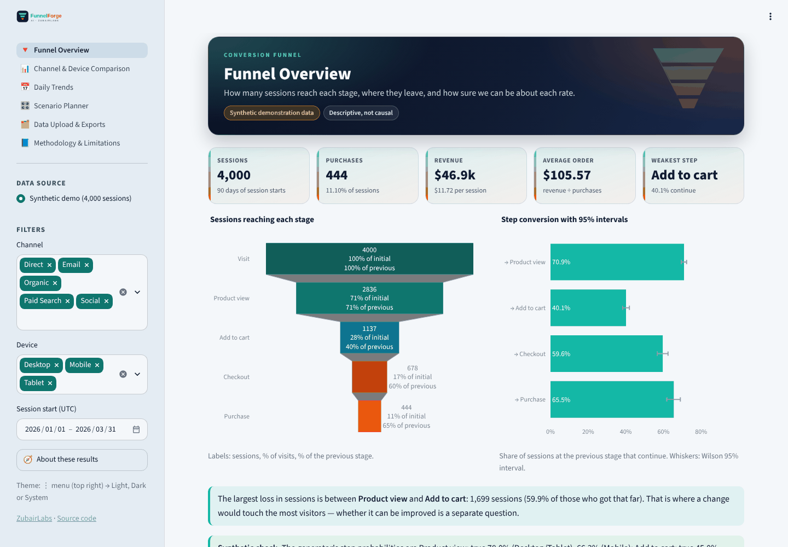
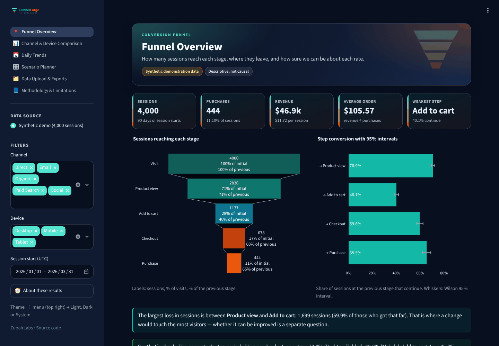
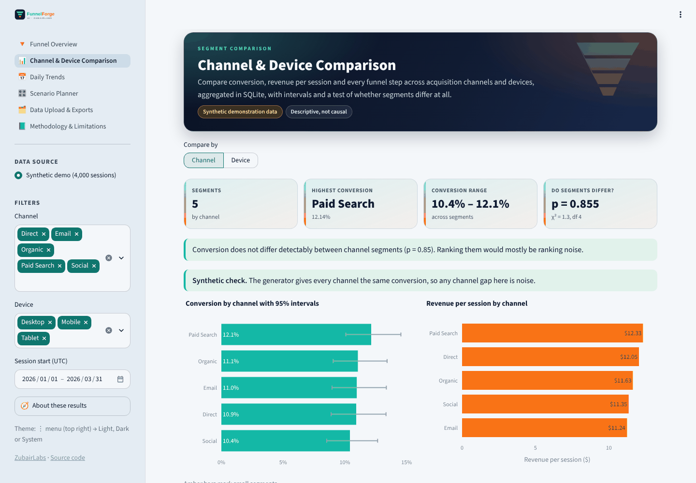
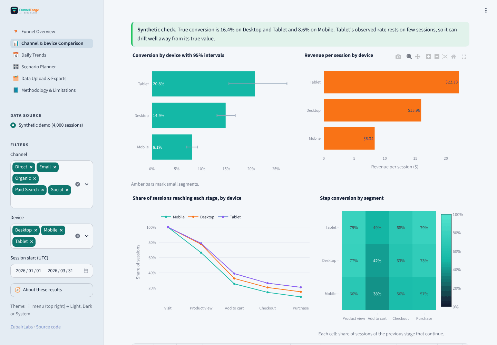
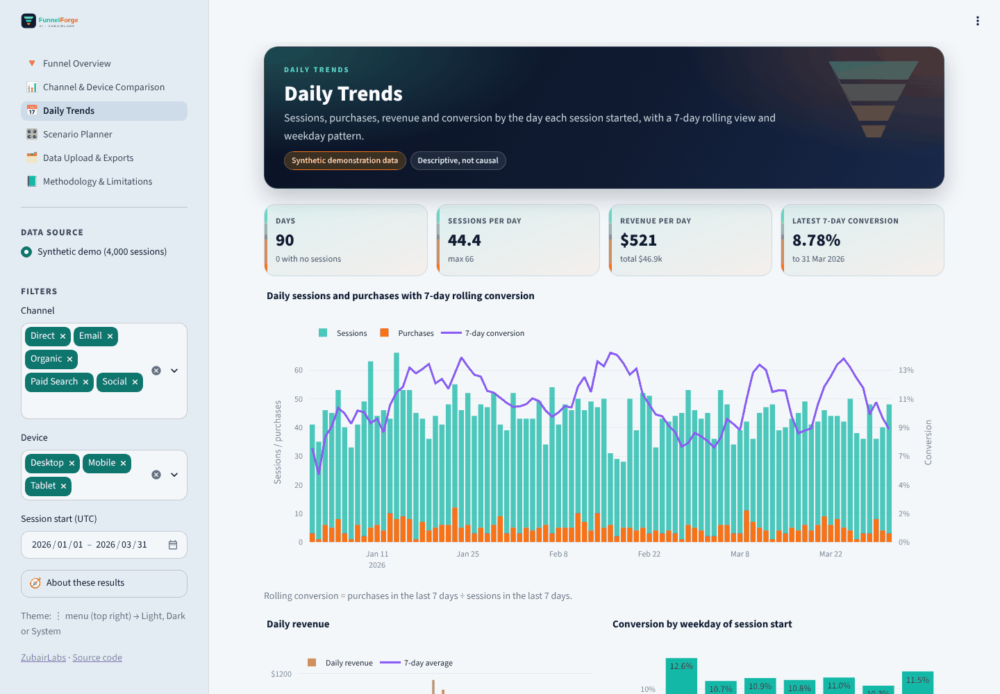
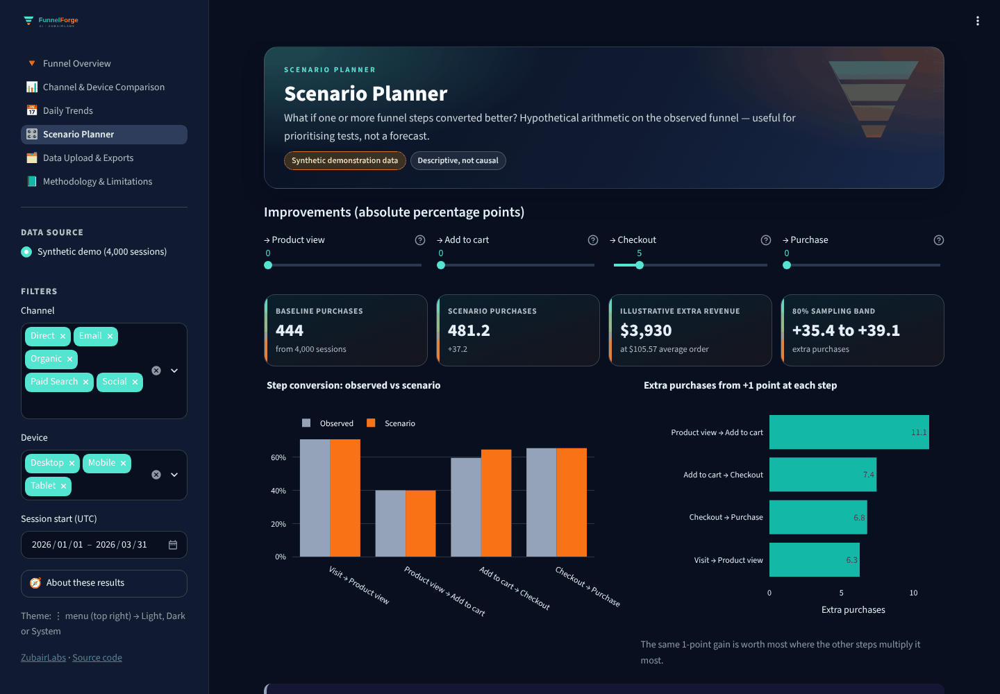
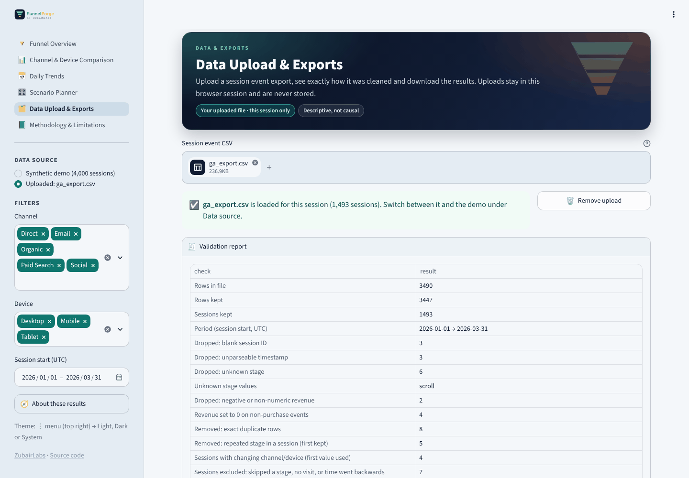
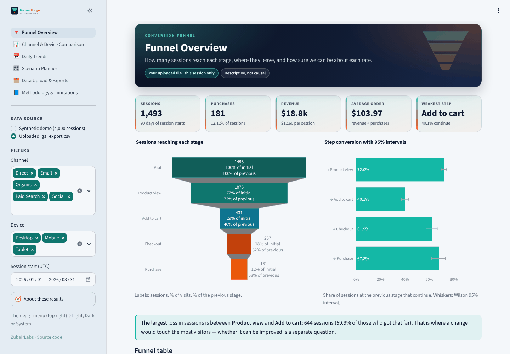
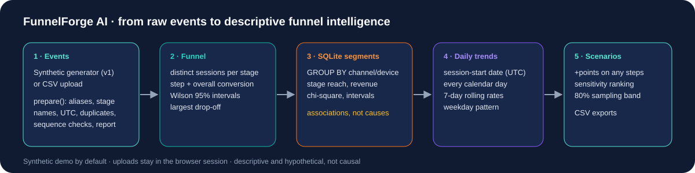

<div align="center">

# FunnelForge AI | ZubairLabs

**Session-level e-commerce conversion intelligence with Python, SQLite and Streamlit — where shoppers leave the
funnel, how channels and devices compare, and what a better step would be worth.**

<!-- LIVE-BADGE -->
[](https://github.com/muhammadzubair-data/funnelforge-ai-conversion-journey-intelligence/actions/workflows/ci.yml)


Built by [ZubairLabs](https://zubairlabs.com) · Muhammad Zubair

</div>

> **Synthetic data, descriptive results.** The bundled sessions are simulated, with known step probabilities.
> Channel and device gaps are associations, not causes; scenarios are hypothetical arithmetic, not forecasts.

## Contents

1. [Live demo](#live-demo) · 2. [What it does](#what-it-does) · 3. [Screenshots](#screenshots) ·
4. [Findings on the demo data](#findings-on-the-demo-data) · 5. [What changed from v1](#what-changed-from-v1) ·
6. [Data contract and uploads](#data-contract-and-uploads) · 7. [Methodology](#methodology) ·
8. [Architecture](#architecture) · 9. [Quick start](#quick-start) · 10. [Tests and CI](#tests-and-ci) ·
11. [Limitations](#limitations) · 12. [Roadmap](#roadmap)

## Live demo

<!-- LIVE-SECTION -->

## What it does

| Page | What you get |
|:--|:--|
| **Funnel Overview** | Sessions, purchases, revenue, average order, weakest step; funnel chart; step conversion with Wilson 95% intervals; largest drop-off; synthetic truth check; CSV export |
| **Channel & Device Comparison** | SQLite aggregation per channel or device; conversion with intervals; chi-square test of whether segments differ; revenue per session; stage-reach lines; step-conversion heatmap; the SQL query; CSV export |
| **Daily Trends** | Every calendar day (zero-session days included), attributed to session start date (UTC); 7-day pooled rolling conversion; daily revenue; weekday pattern; CSV export |
| **Scenario Planner** | Improve any combination of steps by absolute points (capped at 100%); scenario purchases and illustrative revenue; 80% sampling band; "+1 point at each step" ranking; CSV exports |
| **Data Upload & Exports** | Forgiving CSV upload with a validation report; data contract; clean and messy samples; stage filter; four exports |
| **Methodology & Limitations** | Every formula and assumption, and what session-level analytics cannot tell you |

Sidebar filters (channel, device, session-start date range) apply to every page. Uploads live only in the visitor's
browser session.

## Screenshots

All screenshots are real captures of the running app (Playwright, 1440 px).

| Funnel Overview (light) | Funnel Overview (dark) |
|:--:|:--:|
|  |  |

| Channel comparison | Device comparison: stage reach and step heatmap |
|:--:|:--:|
|  |  |

| Daily trends | Scenario planner (dark) |
|:--:|:--:|
|  |  |

| Messy analytics export and validation report | The uploaded export analysed |
|:--:|:--:|
|  |  |

## Findings on the demo data

Reproduce with `python -m scripts.report`.

| Stage | Sessions | Step conversion (95% CI) | Of visits |
|:--|--:|:--|--:|
| Visit | 4,000 | — | 100% |
| Product view | 2,836 | 70.9% (69.5–72.3%) | 70.9% |
| Add to cart | 1,137 | 40.1% (38.3–41.9%) | 28.4% |
| Checkout | 678 | 59.6% (56.8–62.5%) | 17.0% |
| Purchase | 444 | 65.5% (61.8–69.0%) | 11.1% |

- **Biggest leak:** product view → add to cart loses 1,699 sessions (59.9%). The same +1 point there adds 11.1
  purchases, more than at any other step (checkout 7.5, purchase 6.8, product view 6.3).
- **Channels do not differ** (chi-square p = 0.85). The generator gives every channel the same conversion, so the
  10.4–12.1% spread is noise; the app says so instead of crowning a "best channel".
- **Device does** (p < 0.0001): Mobile 8.1% vs Desktop 14.9%, in line with the generator's 8.6% vs 16.4%.
- **Tablet looks best at 20.8%, but that is chance.** Its true rate equals Desktop's (16.4%); with 183 sessions the
  95% interval is 15.5–27.2%, which contains the truth. The app flags the uncertainty rather than ranking it first.
- **Scenario:** +5 points into checkout gives 444 → 481.2 purchases (80% sampling band +35.4 to +39.1) and about
  $3,930 of illustrative revenue — under the stated assumptions only.

## What changed from v1

| v1 | v2 |
|:--|:--|
| Scenario planner crashed on pandas 3 (wrote into a read-only array); 2 of 11 tests failed there | Fixed with a writable copy; original tests pass on pandas 2 and 3 |
| Strict validation: any bad row rejected the file; a per-session Python loop took 6.4 s for 40k sessions | Same rules, vectorised: 0.12 s for 40k sessions. Plus a forgiving `prepare()` for uploads with a full report |
| Exact column and stage names only | Header aliases and analytics event names (`session_start`, `view_item`, `Add to Cart`, `begin_checkout`, `order`); time zones converted to UTC |
| Rates without uncertainty | Wilson 95% intervals on every rate; chi-square test across segments; small-segment flags |
| Days with no sessions vanished from the trend | Every calendar day shown; rolling conversion pools purchases ÷ sessions |
| One-step scenario | Multi-step scenarios, sampling band, sensitivity ranking |
| Single page with tabs; re-validated the upload on every interaction | Six pages, cached per session, light/dark themes, accessible labels |
| 11 tests | 65 tests + Playwright browser suite + CI on Python 3.11/3.12 |

`core.py` keeps the original API (`generate`, `validate`, `funnel`, `segments`, `daily`, `scenario`), and
`data/sample.csv` is still exactly `generate()`.

## Data contract and uploads

One row per event. A session moves through `visit → product_view → add_to_cart → checkout → purchase`.

| column | required | accepted |
|:--|:--|:--|
| `session_id` | yes | also `session`, `visit_id`, `ga_session_id` |
| `timestamp` | yes | any common format; time zones converted to UTC; also `event_time`, `ts`, `date` |
| `stage` | yes | the five names above or common analytics event names |
| `channel` | no | also `utm_source`, `source`; missing → "(unknown)" |
| `device` | no | also `device_type`, `platform`; missing → "(unknown)" |
| `revenue` | no | on purchase events only; also `order_value`, `amount`; missing → 0 |

Cleaning rules, each counted in the validation report:

- Rows with a blank session, an unparseable time, an unknown stage or a negative revenue (refund) are dropped.
- Revenue on non-purchase events is set to 0.
- Exact duplicates are removed; a repeated stage keeps its first event.
- If channel or device changes mid-session, the first value is used.
- Sessions that skip a stage, lack a visit or go backwards in time are excluded rather than guessed at.
- Identical timestamps fall back to stage order.

`sample_data/messy_upload_example.csv` is a GA-style export containing every one of these problems. The report
counts them exactly: 3 blank sessions, 3 bad times, 6 unknown stages, 2 refunds, 4 revenue fixes, 8 duplicates,
5 repeated stages, 4 device changes and 7 broken sessions. The cleaned output passes the original strict `validate()`.

**Privacy and session isolation:** uploads are held in the visitor's Streamlit session only, never written to disk or
to a shared cache, and cleared with **Remove upload**. Tests check that a second session never sees another session's
upload and that the repository gains no files during an upload. Do not upload personal data.

## Methodology

- **Funnel:** distinct sessions reaching each stage. Step conversion = stage ÷ previous stage; overall = stage ÷ visits.
  Zero denominators are undefined, never 0%. Wilson 95% intervals.
- **Segments:** an in-memory SQLite table and one `GROUP BY` query (shown in the app) count sessions per stage,
  purchases and revenue per channel or device. The column name is whitelisted; data values never enter the SQL text
  (tested with a channel named `O'Brien "; DROP TABLE events; --`). Chi-square test of independence (no continuity
  correction), checked against SciPy.
- **Daily:** sessions, purchases and revenue belong to the UTC date the session started; rolling conversion = 7-day
  purchases ÷ 7-day sessions.
- **Scenarios:** purchases = sessions × product of step rates after adding absolute points to the chosen steps (capped
  at 100%); revenue = extra purchases × observed average order value. With no change it reproduces the observed
  purchases exactly. The 80% band re-draws the observed rates 2,000 times (binomial), so it shows sampling noise
  only — not whether the improvement is achievable.

## Architecture



```
funnelforge-ai-conversion-journey-intelligence/
├── app.py                         # Streamlit app, 6 pages
├── core.py                        # backward-compatible v1 API
├── funnelforge/core.py            # preparation, validation, funnel, SQLite segments, daily, scenarios
├── scripts/report.py              # command-line report
├── scripts/make_messy_sample.py   # builds the messy upload sample
├── data/sample.csv                # original synthetic events (4,000 sessions)
├── sample_data/messy_upload_example.csv
├── tests/test_core.py             # original v1 tests (unchanged)
├── tests/test_funnelforge.py      # edge cases, SQL vs pandas, attribution, scenarios
├── tests/test_app.py              # Streamlit AppTest incl. session isolation
├── tests/e2e_ui.py                # Playwright browser checks
├── assets/                        # banner, logo, icon, architecture, screenshots
├── .streamlit/config.toml         # light and dark themes
└── .github/workflows/ci.yml
```

## Quick start

```bash
git clone https://github.com/muhammadzubair-data/funnelforge-ai-conversion-journey-intelligence.git
cd funnelforge-ai-conversion-journey-intelligence
python -m venv .venv && source .venv/bin/activate      # Windows: .venv\Scripts\activate
pip install -r requirements.txt
streamlit run app.py
python -m scripts.report                                # command-line report
```

## Tests and CI

```bash
pip install -r requirements-dev.txt
python -m pytest -q                       # 65 passed
python -m playwright install chromium
streamlit run app.py & python tests/e2e_ui.py http://localhost:8501
```

| Suite | Tests | Covers |
|:--|--:|:--|
| `test_core.py` | 11 | original v1 tests, unchanged |
| `test_funnelforge.py` | 35 | strict and forgiving validation, time zones, ties, repeats, known funnel counts, undefined rates, SQL vs pandas, SQL injection, chi-square vs SciPy, truth coverage, daily attribution and empty days, scenarios |
| `test_app.py` | 19 | every page, upload on every page, **session isolation**, **no files written**, filters, empty filters, dimension switch, scenario sliders |
| `e2e_ui.py` | browser | 6 pages, three exports checked against expected numbers, a live filter, real upload, session persistence, a second browser session, remove, bad file |

GitHub Actions runs compile checks, pytest and the CLI on Python 3.11 and 3.12, then the Playwright job.

## Limitations

- Synthetic data only for every bundled result.
- Descriptive, not causal: segments differ in many ways besides channel or device.
- Session-level, single-touch attribution; no cross-session user identity, no multi-touch attribution, no
  repeated-stage journeys (a repeat keeps its first event).
- Strict funnel order: sessions that skip a stage are excluded, which can undercount if tracking drops events.
- Scenarios hold traffic, other steps and order value fixed; real changes interact.
- Not validated for production decisions.

## Roadmap

Cross-session user journeys · time-to-convert analysis · cohort retention · attribution models with explicit
assumptions · experiment hand-off to an A/B testing tool.

[ZubairLabs](https://zubairlabs.com) · [GitHub](https://github.com/muhammadzubair-data) ·
[LinkedIn](https://www.linkedin.com/in/xubbiofficial/)
