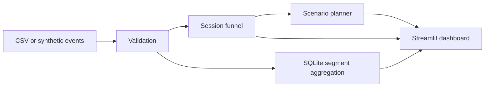

# FunnelForge AI | ZubairLabs

Session-level e-commerce conversion intelligence with Python, SQLite and Streamlit. Explore where shoppers leave a funnel, compare acquisition channels and devices, and simulate improvements to individual transitions.

## Quick start

```bash
python -m pip install -r requirements.txt
python -m pytest -q
streamlit run app.py
```

## Architecture



## Data contract

`data/sample.csv` contains 4,000 synthetic sessions. Columns: session_id, timestamp, channel, device, stage, revenue (USD). Each session must start at visit and follow the contiguous sequence visit → product_view → add_to_cart → checkout → purchase. One event per stage; timestamps must increase; channel and device must be constant within a session. Revenue is nonnegative and only recorded on purchase. Exact duplicates are removed. Daily reports attribute outcomes to session start date (UTC).

## Methodology

Stage counts are distinct sessions; step conversion divides by the preceding stage count; overall conversion divides by visits. SQL aggregates sessions, purchases and revenue by channel/device. Scenario estimates multiply observed transition probabilities after an absolute percentage-point improvement to one transition, capped at 100%. Incremental revenue uses observed average purchase value. Zero-denominator step rates are undefined. These are descriptive and hypothetical estimates, not causal effects or validated forecasts. No user-level cross-session identity, multi-touch attribution or repeated-stage journeys are supported.

## Deployment

Publish the directory to GitHub and deploy `app.py` on Streamlit Community Cloud with Python 3.11. See the combined publishing prompt. Do not upload private customer data or secrets. No paid API is needed.

## Tests

Eleven core tests cover reproducibility, funnel counts, SQL aggregation, revenue reconciliation, daily aggregation, scenario behavior and invalid input. Browser testing and public deployment are separate verification steps.

[ZubairLabs](https://zubairlabs.com) · [GitHub](https://github.com/muhammadzubair-data)
